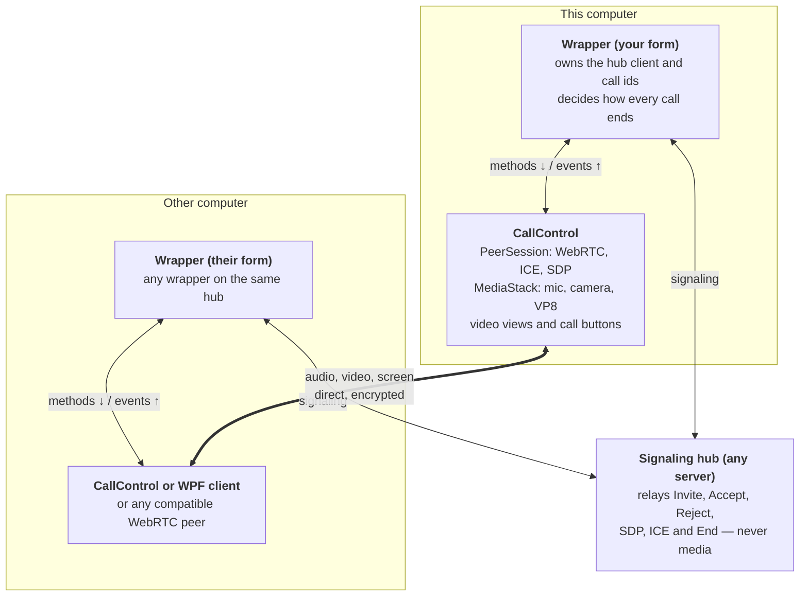
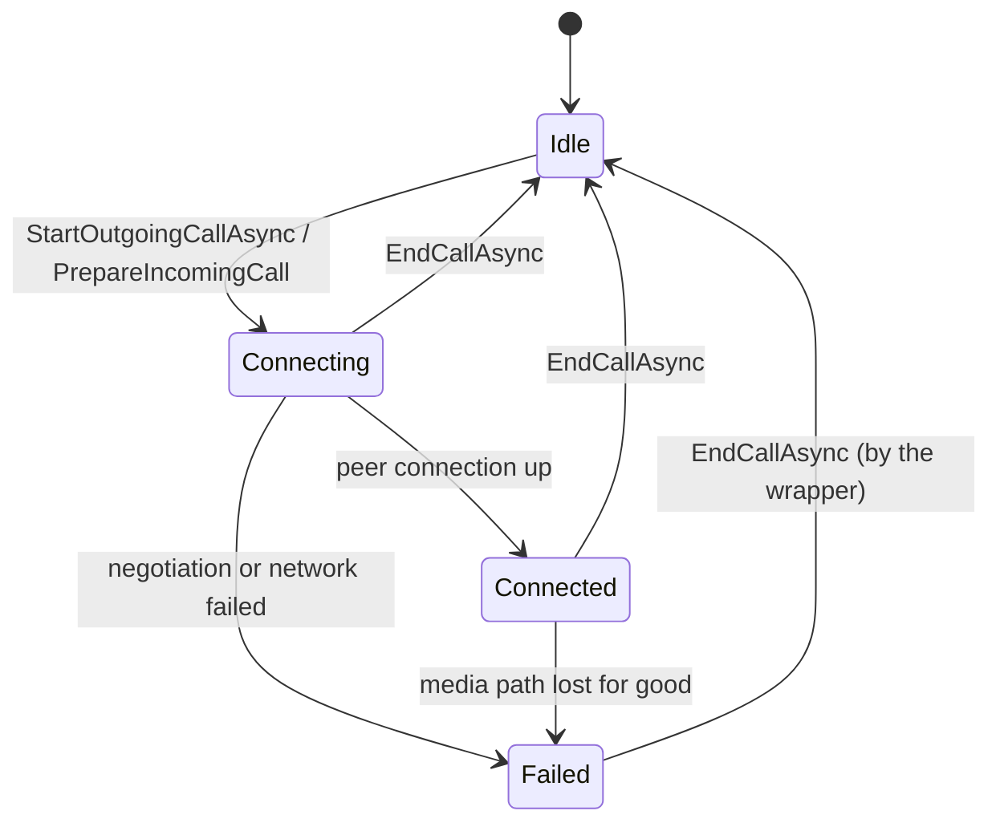
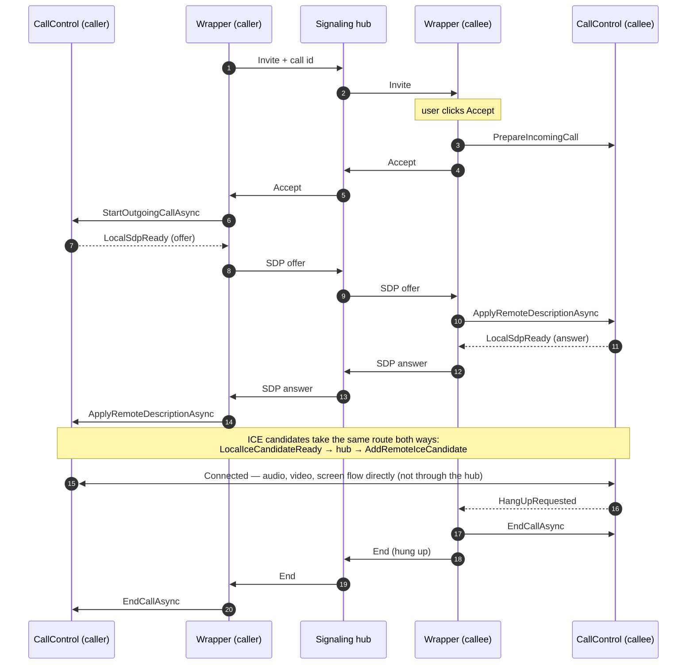

# CallControl — integrating other signaling hubs

Any signaling hub can drive `CallControl`. You write a small **wrapper** that carries the
control's SDP and ICE messages over that hub, and the control itself does not change.

`CallControl` (`src/IntraTeams.WinForms/Controls`) does 1-to-1 audio, video and screen
sharing over WebRTC using SIPSorcery. It has no reference to SignalR, users, rosters or
chat. `MainForm` is today's wrapper for the IntraTeams SignalR hub. This guide shows how to
write another one, for example for a different SignalR hub, a raw WebSocket server, a
message bus or an existing in-house messaging system.

**Audience:** developers integrating `CallControl` into a WinForms application that already
has, or will have, its own signaling server.

**Contents**

1. [The three roles](#1-the-three-roles)
2. [CallControl API contract](#2-callcontrol-api-contract)
3. [What the hub must carry](#3-what-the-hub-must-carry)
4. [End-to-end call flow](#4-end-to-end-call-flow)
5. [Failure, cancel and reconnect flows](#5-failure-cancel-and-reconnect-flows)
6. [Writing a wrapper for another hub](#6-writing-a-wrapper-for-another-hub)
7. [Rules and constraints](#7-rules-and-constraints)
8. [Reference implementation: MainForm](#8-reference-implementation-mainform)
9. [Integration checklist](#9-integration-checklist)

---

## 1. The three roles

Three pieces cooperate in every call, and only the wrapper knows about the hub.



Each wrapper talks to the hub and to its own `CallControl`. The two controls talk only to
each other, and only after the hub has helped them find each other.

| Role | In IntraTeams | Owns | Never does |
| --- | --- | --- | --- |
| Signaling hub | `IntraTeams.Server` (SignalR) | Delivering messages between users, presence | Touch audio or video |
| Wrapper (mediator) | `MainForm` + `SignalingClient` | Hub connection, user ids, call ids, call setup and endings, chat | Encode, decode or open devices |
| CallControl | `Controls/CallControl.cs` | Peer connection, ICE, SDP, devices, video views, in-call buttons | Know who the peer is or how to reach them |

---

## 2. CallControl API contract

The whole contract is five methods in and five events out. Everything a wrapper does goes
through these.

### Methods the wrapper calls (always on the UI thread)

| Member | Who calls it | When | What the control does |
| --- | --- | --- | --- |
| `Settings` (property) | Both | Once, before the first call | Camera device, resolution, fps, screen-share width and fps (type `AppConfig`) |
| `StartOutgoingCallAsync(peerName, withVideo)` | Caller | After the callee has accepted | Builds the media session, then raises `LocalSdpReady` with an **offer** |
| `PrepareIncomingCall(peerName, withVideo)` | Callee | After the user clicks Accept, **before** telling the caller | Builds the media session and waits for the offer |
| `ApplyRemoteDescriptionAsync(type, sdp)` | Both | When the peer's offer or answer arrives | Applies it; for an offer, also raises `LocalSdpReady` with an **answer** |
| `AddRemoteIceCandidate(candidate, sdpMid, sdpMLineIndex, usernameFragment)` | Both | Each time a peer candidate arrives | Adds it, or queues it until the remote description is set |
| `EndCallAsync(statusText)` | Both | Whenever the call ends, for any reason | Closes the peer connection and every device; safe to call when idle |

### Events the control raises (always on the UI thread)

| Event | Payload | Wrapper must |
| --- | --- | --- |
| `LocalSdpReady` | `Type` ("offer" or "answer"), `Sdp` | Send both strings to the peer |
| `LocalIceCandidateReady` | `Candidate`, `SdpMid`, `SdpMLineIndex`, `UsernameFragment` | Send all four fields to the peer |
| `StateChanged` | `State`, `Detail` | Update its UI; on `Failed`, end the call (see [section 5](#5-failure-cancel-and-reconnect-flows)) |
| `HangUpRequested` | none | Tell the peer the call is over, then call `EndCallAsync` |
| `Diagnostic` | `Message` | Optionally write it to a log |

### States



`Failed` means negotiation or the network path failed. The session is still allocated until
the wrapper calls `EndCallAsync`, which returns the control to `Idle`.

Read-only helpers: `HasSession` (true between Start/Prepare and EndCall), `IsMuted`,
`IsCameraOn`, `IsScreenSharing`.

---

## 3. What the hub must carry

The hub needs to relay six kinds of message between exactly two users. Names and wire format
are up to you.

| Message | Direction | Fields | Used for |
| --- | --- | --- | --- |
| Invite | caller → callee | call id, caller id, caller display name, with-video flag | Ringing the callee |
| Accept | callee → caller | call id | Tells the caller to create the offer |
| Reject | callee → caller | call id, reason (declined / busy) | Ending a call that never started |
| SDP | either way | call id, type ("offer" / "answer"), sdp text | Media negotiation |
| ICE candidate | either way | call id, candidate, sdpMid, sdpMLineIndex, usernameFragment | Finding the network path |
| End | either way | call id, reason (hung up / cancelled / failed) | Hanging up at any stage |

Requirements on the hub:

- **Addressing.** It must deliver a message to one specific user (by connection id, user id
  or similar). `CallControl` never sees these ids; the wrapper keeps them.
- **Ordering per pair.** Messages between the same two users should arrive in the order sent.
  ICE candidates may overtake an SDP message; the control and the wrapper both tolerate that.
- **Size.** An SDP is typically a few KB of text. The IntraTeams hub raises SignalR's 32 KB
  default to 256 KB for headroom; make sure your hub's limit is not below about 16 KB.
- **Presence (optional).** A roster or "user went offline" signal lets the wrapper end calls
  that are ringing when the other side disappears. Without it, use a ring timeout.
- **Call id.** Generate one per call attempt (a GUID) and put it on every message, so a late
  message from a previous call is ignored.

The hub never sees media. Once connected, audio and video travel directly between the two
computers.

---

## 4. End-to-end call flow

A call is invite, accept, offer, answer, ICE, then media. The hub relays every signaling
message, and the wrapper on each side translates it for its control.



ICE candidates start flowing as soon as each side builds its session (the callee at
`PrepareIncomingCall`, the caller at `StartOutgoingCallAsync`), so they interleave with the
SDP messages. Either side can hang up: it tears down its own control first, then sends End.

---

## 5. Failure, cancel and reconnect flows

Every way a call can end finishes the same way on both sides: the wrapper calls
`EndCallAsync` on its control and returns to idle.

| Situation | Detected by | This side's wrapper | Message to peer | Peer's wrapper |
| --- | --- | --- | --- | --- |
| User clicks Hang up in the control | `HangUpRequested` | `EndCallAsync`, then send End | End (hung up) | `EndCallAsync` |
| Caller cancels while ringing | Wrapper's Cancel button | Send End; no session exists yet | End (cancelled) | Close the ringing dialog |
| No answer | Wrapper's ring timer (MainForm: 45 s) | Same as cancel | End (cancelled) | Close the ringing dialog |
| Callee declines | Ringing dialog | Send Reject | Reject (declined) | Show "declined", back to idle |
| Callee already in a call | Wrapper sees an Invite while not idle | Send Reject automatically | Reject (busy) | Show "busy", back to idle |
| Negotiation or network fails | `StateChanged` = `Failed` | `EndCallAsync`, then send End | End (failed) | `EndCallAsync` |
| Peer's app crashes or loses the hub | Hub presence / disconnect notice | `EndCallAsync` | none | n/a |
| This side loses the hub | Hub client's reconnecting / closed event | `EndCallAsync` (the call cannot be resumed) | none | Learns via presence |

Two rules make these safe:

1. **Tear down locally first, then signal.** Hang up must take effect immediately even if the
   hub is slow or unreachable.
2. **Ignore anything that does not match the current call id and peer.** A late Accept for a
   call you already cancelled should be answered with End, so the server does not leave both
   users marked busy (MainForm does this in `OnCallAccepted`).

`CallControl` never decides to end a call on its own. It reports `Failed` or
`HangUpRequested`; the wrapper decides what to tell the peer.

---

## 6. Writing a wrapper for another hub

A working wrapper for a different hub fits in about 130 lines: wire the control's events to
hub sends, wire hub messages to control methods, and keep the call id and peer id.

1. **Make the control available to your app.** Today `CallControl` lives inside the
   `IntraTeams.WinForms` exe. Either add the files to your project, or move them into a class
   library. Files needed: `Controls/CallControl*.cs`, `Controls/VideoView.cs`, plus the
   linked `PeerSession.cs`, `MediaStack.cs`, `GdiScreenCapture.cs`, `AppConfig.cs`. Target
   `net10.0-windows10.0.17763.0` and reference the same packages (`SIPSorcery` 10.0.16,
   `SIPSorceryMedia.Windows` 10.0.15, `SIPSorcery.VP8` 10.0.16, plus your hub's client
   library).
2. **Place the control on your form** and set `callControl.Settings` once.
3. **Control → hub.** Handle `LocalSdpReady`, `LocalIceCandidateReady`, `HangUpRequested` and
   `StateChanged` (`Failed`) by sending to the peer.
4. **Hub → control.** For each incoming hub message, switch to the UI thread (`BeginInvoke`)
   and call the matching control method.
5. **Call setup.** Generate a call id and send Invite. On the callee, call
   `PrepareIncomingCall` **before** sending Accept. On the caller, call
   `StartOutgoingCallAsync` when Accept arrives.
6. **Endings.** Implement every row of the [failure table](#5-failure-cancel-and-reconnect-flows),
   tearing down locally first.
7. **Test** with two instances on one machine, then across two machines (`TESTING.md`,
   phases 4–10).

### Example

A wrapper for a hypothetical SignalR hub whose methods are `Ring`, `Accept`, `Reject`,
`Relay`, `Ice` and `Bye`. The hub relays each call to the named user and adds the sender's
id as `from`.

```csharp
using System.Windows.Forms;
using IntraTeams.Client.Infrastructure;
using IntraTeams.WinForms.Controls;
using Microsoft.AspNetCore.SignalR.Client;

public record SdpDto(string CallId, string Type, string Sdp);
public record IceDto(string CallId, string Candidate, string? SdpMid, int SdpMLineIndex, string? UsernameFragment);

public partial class OtherHubCallForm : Form
{
    private readonly HubConnection _hub;
    private readonly List<IceDto> _earlyIce = new();
    private string _peerId = "", _callId = "";
    private bool _withVideo;

    public OtherHubCallForm(string hubUrl, AppConfig mediaSettings)
    {
        InitializeComponent();                 // the designer adds callControl
        callControl.Settings = mediaSettings;

        // ---- control -> hub (control events already arrive on the UI thread)
        callControl.LocalSdpReady += async (_, e) =>
            await _hub.SendAsync("Relay", _peerId, new SdpDto(_callId, e.Type, e.Sdp));
        callControl.LocalIceCandidateReady += async (_, e) =>
            await _hub.SendAsync("Ice", _peerId,
                new IceDto(_callId, e.Candidate, e.SdpMid, e.SdpMLineIndex, e.UsernameFragment));
        callControl.HangUpRequested += async (_, _) => await EndAsync("hungup");
        callControl.StateChanged += async (_, e) =>
        {
            if (e.State == CallControlState.Failed) await EndAsync("failed");
        };

        // ---- hub -> control (hub callbacks arrive on pool threads: marshal first)
        _hub = new HubConnectionBuilder().WithUrl(hubUrl).WithAutomaticReconnect().Build();

        _hub.On<string, string, bool>("Ring", (from, callId, video) => Ui(() => OnRing(from, callId, video)));

        _hub.On<string, string>("Accept", (from, callId) => Ui(async () =>
        {
            if (from != _peerId || callId != _callId) return;
            await callControl.StartOutgoingCallAsync(from, _withVideo);   // raises the offer
            foreach (var c in _earlyIce) AddIce(c);                       // candidates that beat the Accept
            _earlyIce.Clear();
        }));

        _hub.On<string, string, string>("Reject", (from, callId, reason) => Ui(async () =>
        {
            if (callId == _callId) await ResetAsync();
        }));

        _hub.On<string, SdpDto>("Relay", (from, m) => Ui(async () =>
        {
            if (from == _peerId && m.CallId == _callId)
                await callControl.ApplyRemoteDescriptionAsync(m.Type, m.Sdp);
        }));

        _hub.On<string, IceDto>("Ice", (from, m) => Ui(() =>
        {
            if (from != _peerId || m.CallId != _callId) return;
            if (callControl.HasSession) AddIce(m); else _earlyIce.Add(m);
        }));

        _hub.On<string, string, string>("Bye", (from, callId, reason) => Ui(async () =>
        {
            if (callId == _callId) await ResetAsync();
        }));

        // Losing the hub ends the call: the peer can no longer reach us.
        _hub.Reconnecting += _ => { Ui(async () => await ResetAsync()); return Task.CompletedTask; };
    }

    public Task ConnectAsync() => _hub.StartAsync();

    // Caller side
    public async Task CallAsync(string peerId, bool withVideo)
    {
        if (callControl.HasSession || _callId != "") return;
        _peerId = peerId;
        _callId = Guid.NewGuid().ToString("N");
        _withVideo = withVideo;
        await _hub.SendAsync("Ring", peerId, _callId, withVideo);
    }

    // Callee side
    private async void OnRing(string from, string callId, bool withVideo)
    {
        if (_callId != "")
        {
            await _hub.SendAsync("Reject", from, callId, "busy");
            return;
        }

        // Use a non-modal prompt in a real app (see IncomingCallForm); a MessageBox blocks.
        if (MessageBox.Show($"{from} is calling. Answer?", "Incoming call", MessageBoxButtons.YesNo) != DialogResult.Yes)
        {
            await _hub.SendAsync("Reject", from, callId, "declined");
            return;
        }

        _peerId = from;
        _callId = callId;
        callControl.PrepareIncomingCall(from, withVideo);   // session FIRST
        await _hub.SendAsync("Accept", from, callId);       // THEN accept
    }

    private void AddIce(IceDto c)
        => callControl.AddRemoteIceCandidate(c.Candidate, c.SdpMid, c.SdpMLineIndex, c.UsernameFragment);

    // Local teardown first, then tell the peer.
    private async Task EndAsync(string reason)
    {
        var peer = _peerId;
        var id = _callId;
        await ResetAsync();
        if (peer != "") await _hub.SendAsync("Bye", peer, id, reason);
    }

    private async Task ResetAsync()
    {
        _peerId = "";
        _callId = "";
        _earlyIce.Clear();
        await callControl.EndCallAsync();
    }

    private void Ui(Action action)
    {
        if (!IsDisposed) BeginInvoke(action);
    }
}
```

The example leaves out what `MainForm` adds on top: a roster, a ring timeout, a Cancel
button while ringing, and the stale-Accept clean-up. Copy those from `MainForm.cs` when your
hub needs them.

---

## 7. Rules and constraints

Breaking any of these gives a call that signals fine but never carries media, so check them
before debugging anything else.

| Rule | Why | What goes wrong if broken |
| --- | --- | --- |
| Exactly one side creates the offer: the caller, after Accept | The control has no handling for both sides offering at once ("glare") | Both sides wait for an answer that never comes |
| The callee calls `PrepareIncomingCall` before sending Accept | The offer follows the Accept immediately and needs a session to land in | "Remote offer arrived with no active session - ignored" |
| Call control methods on the UI thread; expect events on the UI thread | The control owns WinForms child controls | `InvalidOperationException: CallControl methods must be called on the UI thread` |
| One call per control; `EndCallAsync` before the next call | One peer connection and one set of devices per control | `InvalidOperationException: This CallControl already has an active call` |
| Send ICE candidates as they appear (trickle) and accept them in any order | Candidates can arrive before the SDP; the control queues them, the wrapper buffers any that arrive before the session exists | Missing candidates can leave ICE stuck at "checking" |
| Both computers on the same network, reachable directly | Only `host` ICE candidates are used; STUN/TURN candidates are rejected by design | Never reaches `connected` across NAT or the internet |
| The far end speaks standard WebRTC with VP8 video and G.711/G.722 audio | Those are the only codecs offered | Negotiation fails (`Failed` state) |
| UDP allowed between the two machines | Media uses ephemeral UDP ports | Connects on signaling, silent on media; allow the app in Windows Firewall |

The far end does not have to be `CallControl`. The WPF client, or any SIPSorcery or browser
WebRTC peer that meets the codec and network rules, works, as long as your hub carries the
same messages to it.

---

## 8. Reference implementation: MainForm

`src/IntraTeams.WinForms/MainForm.cs` is the complete wrapper for the IntraTeams SignalR hub.
Use it as the model when your hub needs more than the example above.

### Hub → control (through `SignalingClient` events)

| IntraTeams hub message | MainForm handler | CallControl call |
| --- | --- | --- |
| `IncomingCall` | `OnIncomingCall` → ringing dialog → `AcceptIncomingCall` | `PrepareIncomingCall`, then hub `AcceptCall` |
| `CallAccepted` | `OnCallAccepted` | `StartOutgoingCallAsync`, then releases held ICE |
| `ReceiveSdp` | `OnRemoteSdp` | `ApplyRemoteDescriptionAsync` |
| `ReceiveIceCandidate` | `OnRemoteIceCandidate` | `AddRemoteIceCandidate` (or holds it) |
| `CallRejected` / `CallEnded` | `OnCallRejected` / `OnCallEnded` | `EndCallAsync` |
| `RosterChanged` (peer missing) | `ApplyRoster` | `EndCallAsync` |
| Reconnecting / Closed | `OnSignalingReconnecting` / `OnSignalingClosed` | `EndCallAsync` |

### Control → hub

| CallControl event | MainForm handler | IntraTeams hub method |
| --- | --- | --- |
| `LocalSdpReady` | `OnLocalSdpReady` | `SendSdp` |
| `LocalIceCandidateReady` | `OnLocalIceCandidateReady` | `SendIceCandidate` |
| `HangUpRequested` | `HangUp` | `EndCall` (or `RejectCall` while ringing) |
| `StateChanged` = `Failed` | `OnCallControlStateChanged` | `EndCall` (failed) |

Chat, the roster and registration also go through `MainForm` but never touch `CallControl`.

---

## 9. Integration checklist

- [ ] Hub can address one user and relays Invite, Accept, Reject, SDP, ICE, End
- [ ] Every message carries a call id; stale ones are ignored
- [ ] `callControl.Settings` set before the first call
- [ ] All five control events handled; `Diagnostic` written to a visible log
- [ ] Every hub callback marshalled to the UI thread before touching the control
- [ ] Callee: `PrepareIncomingCall` before Accept; caller: `StartOutgoingCallAsync` on Accept
- [ ] ICE that arrives before the caller's session exists is held, then released
- [ ] Every ending in the failure table handled; local teardown before signalling
- [ ] Ring timeout, or presence, so an unanswered call does not ring forever
- [ ] Tested on one machine, then between two machines with the firewall prompt allowed
